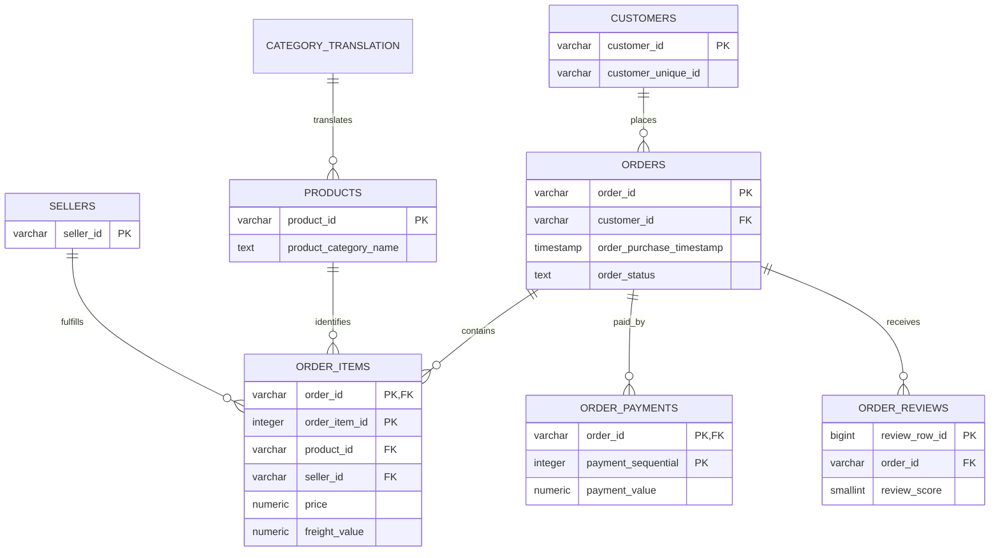

# Entity-Relationship Diagram

`raw.geolocation` intentionally has no enforced foreign key because the source contains multiple observations per ZIP-code prefix and must be aggregated before use as a geographic lookup.
